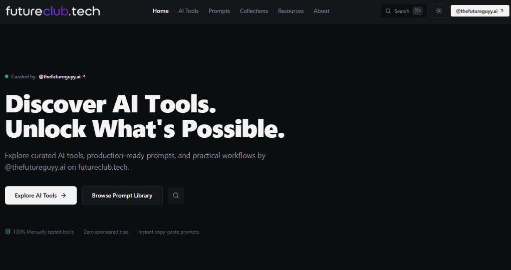
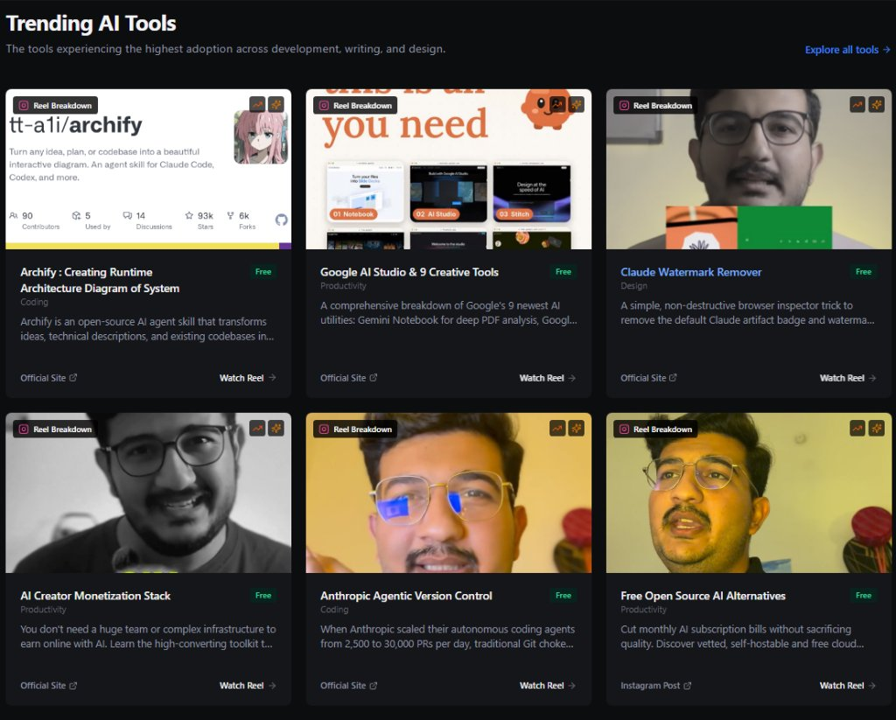
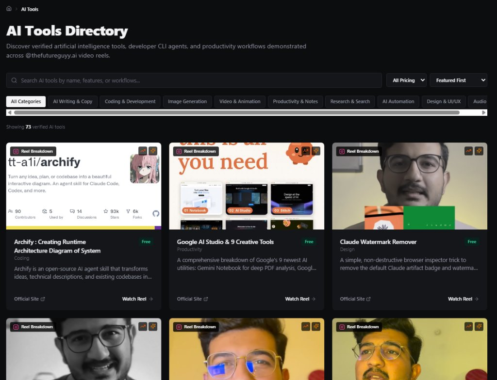
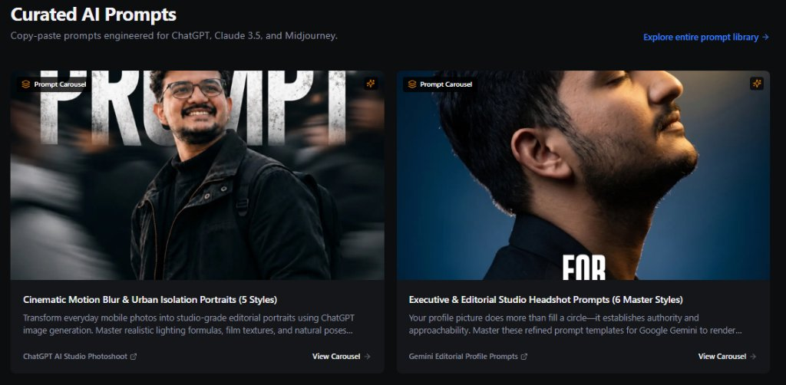

# FutureClub.tech — The Companion AI Knowledge Hub for @thefutureguyy.ai

[](#pre-flight-design--data-validation)
[](#pre-flight-design--data-validation)
[](LICENSE)

**FutureClub.tech** (`futureclub.tech`) is the official discovery directory, prompt repository, and video breakdown hub created for the **[@thefutureguyy.ai](https://www.instagram.com/thefutureguyy.ai/)** community.

It bridges the gap between fast-paced social video reels and practical execution: giving creators, developers, students, and founders instant access to tested AI tools, one-click copyable prompts, and deep-dive technical explanations.

---

## What is FutureClub.tech?

On Instagram, [@thefutureguyy.ai](https://www.instagram.com/thefutureguyy.ai/) shares daily breakdowns of high-impact AI developer tools, automation workflows, and image generation formulas. However, social video platforms make it impossible to:
1. **Copy complex system prompts** without typos or missing formatting.
2. **Access direct tool repositories** (GitHub repos, npm packages, web apps) directly from video descriptions.
3. **Search past reel topics** by category, workflow, or keyword.

**FutureClub.tech solves this completely:**
- **Zero Sponsored Bias**: Every tool, extension, and agent skill featured has been manually vetted and tested.
- **Instant Copy-Paste**: Multi-stage prompts, terminal commands, and system instructions can be copied in one click.
- **Embedded Reel Synchronicity**: Every tool and prompt page links directly back to the original Instagram video breakdown with an embedded player.
- **Original Series ("2 Minute me samjo")**: Deep technical breakdowns of bleeding-edge AI research explained in simple, bite-sized Hindi/English.

---

## Visual Platform Tour

### 1. Discover AI Tools & Instant Search
Explore curated AI tools, production-ready prompts, and practical workflows with instant <kbd>Cmd</kbd> + <kbd>K</kbd> / <kbd>Ctrl</kbd> + <kbd>K</kbd> keyboard search.



### 2. Trending AI Tools
Stay ahead with the highest-adoption developer tools, agent skills, and creative utilities—including Archify, Google AI Studio, and autonomous coding tools.



### 3. AI Tools Directory with Filter & Categories
Browse and filter across categories like *Coding & Development*, *Image Generation*, *Productivity & Notes*, *AI Automation*, and *Design & UI/UX*.



### 4. Curated AI Prompt Library
Field-tested prompt formulas engineered for ChatGPT, Claude 3.5 Sonnet, Google Gemini, Midjourney v6, and Flux. Complete with step-by-step instructions.



---

## Key Platform Sections

| Section | Route | Purpose |
| :--- | :--- | :--- |
| **Home** | `/` | Daily trending tools, prompt carousels, and spotlight original series. |
| **AI Tools** | `/tools` | Full searchable directory of verified tools with pricing filters and command guides. |
| **Prompts** | `/prompts` | Ready-to-use prompt templates with copy button and parameter customization. |
| **Series** | `/series` | **"2 Minute me samjo"** video series and blog articles explaining AI research. |
| **Search** | `Cmd+K` | Instant global search across tools, prompts, guides, and research topics. |

---

## Original Series: "2 Minute me samjo"

The **Series** section (`/series`) hosts original technical explainer series designed to explain complex AI research papers and architecture in 2 minutes:

- **Episode 01 — Weight Space Programming**: How LLMs can directly inspect and edit neural network weights (tensors) via natural-language instructions without backpropagation or fine-tuning datasets (MIT CSAIL & Stanford research).
- **Layout**: Features the embedded Instagram video breakdown on the left, paired with an in-depth, structured blog article, code examples, and research references on the right.

---

## Content Architecture (For Contributors & Creators)

The entire platform is powered by clean, typed static JSON files—requiring zero runtime database or external backend.

### 1. Reel & Tool Content (`src/data/reels/*.json`)
Every Instagram Reel breakdown is stored in its own isolated JSON file in `src/data/reels/`:
- **`toolName` & `toolUrl`**: Name and official site or GitHub repo.
- **`description`**: Structured overview and instructions.
- **`promptSet`**: Array of prompts with copyable text and steps.
- **`instagramReelUrl`**: Direct link to the Instagram reel.
- **`reelThumbnail`**: Thumbnail asset path (`public/assets/reels/...`).

### 2. Series Content (`src/data/series.json` & `src/data/series-posts.json`)
Defines video series hubs and detailed episode blog articles with structured sections, takeaways, and academic references.

---

## Quickstart & Local Development

### 1. Install Dependencies
```bash
npm install
```

### 2. Run Local Development Server
```bash
npm run dev
```
Open [http://localhost:3000](http://localhost:3000) to view the live site.

### 3. Run Pre-flight Checks & Validation
Verify schema integrity and anti-slop design standards:

```bash
# Validate all JSON files against Zod schemas
npm run validate:data

# Run Taste Skill anti-slop design check (must be 0 FAIL, 0 WARN)
npm run lint:taste
```

### 4. Build & Prerender Static HTML
```bash
npm run build
```
Generates 190+ prerendered static HTML pages in `dist/` with automated meta tags, OpenGraph previews, Schema.org JSON-LD data, and updated `sitemap.xml`.

---

## Deployment & Hosting

The static output is optimized for zero-maintenance edge hosting:

### Vercel / Cloudflare Pages / Netlify
- **Framework Preset**: Vite
- **Build Command**: `npm run build`
- **Output Directory**: `dist`
- **Node Version**: 20+

---

## Google AdSense & Analytics Configuration

Configurable via `.env`:
```env
VITE_ADSENSE_ENABLED=true
VITE_ADSENSE_CLIENT=ca-pub-XXXXXXXXXXXXXXXX
VITE_ADSENSE_SLOT_HOME=1234567890
VITE_ADSENSE_SLOT_TOOLS=2345678901
VITE_ADSENSE_SLOT_PROMPTS=3456789012
VITE_ADSENSE_SLOT_DETAILS=4567890123
VITE_GA4_MEASUREMENT_ID=G-XXXXXXXXXX
```

---

## Creator & Community

- **Instagram**: [@thefutureguyy.ai](https://www.instagram.com/thefutureguyy.ai/)
- **Website**: [futureclub.tech](https://futureclub.tech)
- **Author**: Shyamal (The Future Guy AI)
